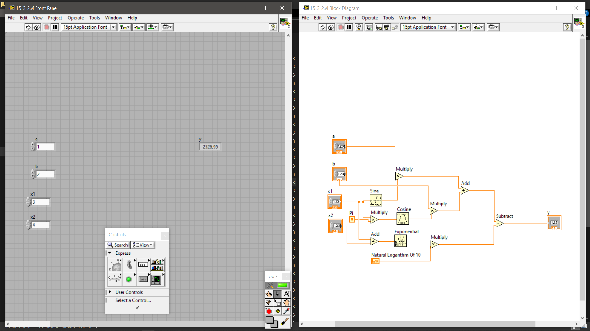
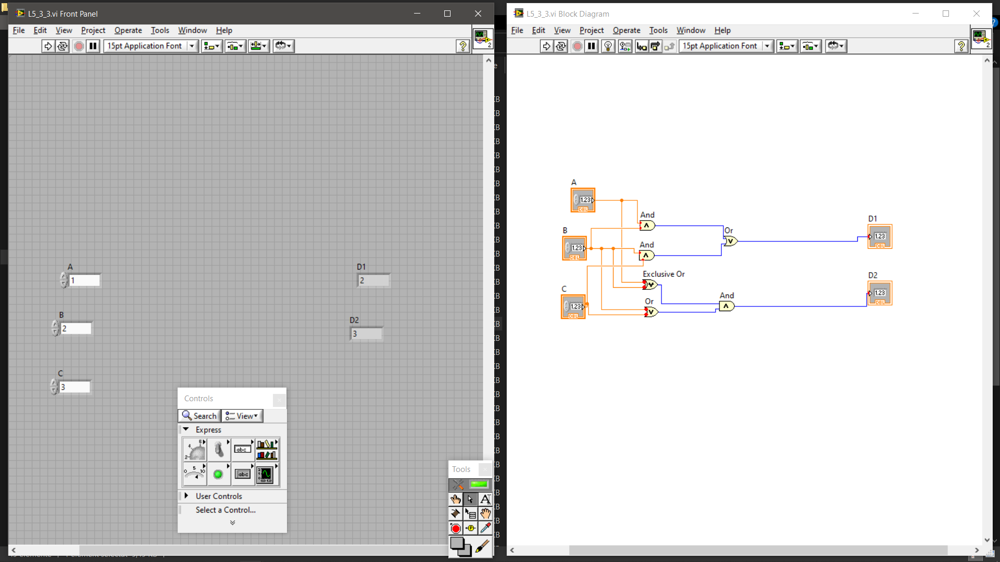
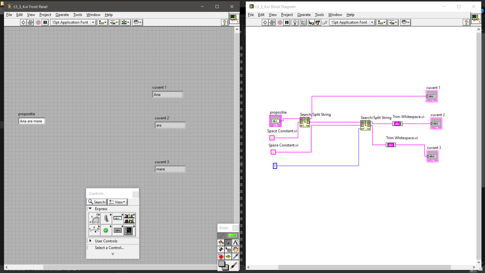
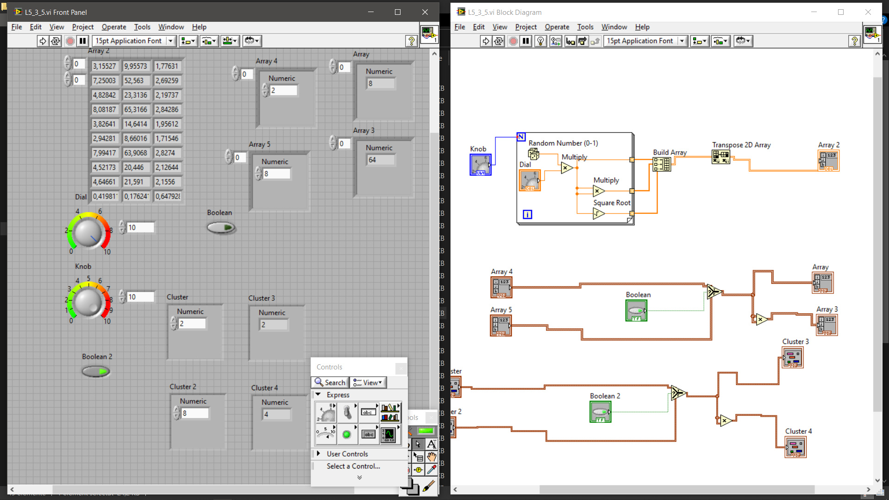

# Aplicații de prelucrare a datelor în LabVIEW

---

# 🇷🇴 Română

## 1. Descrierea proiectului

Acest proiect conține patru aplicații independente dezvoltate în **LabVIEW**, axate pe prelucrarea datelor prin intermediul programării grafice.

Proiectul evidențiază utilizarea funcțiilor matematice și logice, manipularea șirurilor de caractere și gestionarea structurilor de date de tip Array și Cluster.

Fiecare aplicație utilizează elemente specifice mediului LabVIEW, precum controale și indicatoare, noduri funcționale, conexiuni de date și structuri de programare.

## 2. Aplicații și implementare

### 2.1. Operații matematice

**Fișier:** `L5_3_2.vi`

**Descriere:**

Aplicația realizează procesarea unor valori numerice de intrare prin combinarea operațiilor aritmetice și a funcțiilor matematice. Rezultatul este obținut prin conectarea succesivă a nodurilor funcționale în diagrama Block Diagram.

**Date de intrare:**
- `a`, `b` – valori numerice utilizate în operațiile aritmetice.
- `x1`, `x2` – valori numerice utilizate în calculul expresiilor matematice.

**Procesare:**
- Înmulțirea valorilor numerice.
- Calcularea funcțiilor trigonometrice Sinus și Cosinus.
- Aplicarea funcției exponențiale.
- Calcularea logaritmului natural.
- Combinarea rezultatelor intermediare prin operații de adunare, înmulțire și scădere.

**Date de ieșire:**
- `y` – rezultatul final al expresiei matematice.

**Concepte LabVIEW utilizate:**
- Numeric Controls și Numeric Indicators.
- Multiply, Add și Subtract.
- Sine și Cosine.
- Exponential Function.
- Natural Logarithm.
- Dataflow Programming.

**Captură de ecran:**



### 2.2. Operații logice

**Fișier:** `L5_3_3.vi`

**Descriere:**

Aplicația implementează expresii logice utilizând trei valori de intrare. Datele sunt procesate prin intermediul funcțiilor Boolean AND, OR și Exclusive OR (XOR), iar rezultatele operațiilor sunt combinate pentru obținerea a două ieșiri.

**Date de intrare:**
- `A`
- `B`
- `C`

**Procesare:**
- Aplicarea operației AND asupra unor combinații ale intrărilor.
- Aplicarea operației OR pentru combinarea rezultatelor logice.
- Aplicarea operației Exclusive OR (XOR).
- Combinarea expresiilor logice prin funcții AND și OR.

**Date de ieșire:**
- `D1` – primul rezultat al expresiei logice.
- `D2` – al doilea rezultat al expresiei logice.

**Concepte LabVIEW utilizate:**
- Boolean Logic.
- AND Function.
- OR Function.
- Exclusive OR Function.
- Functional Nodes.
- Dataflow Programming.

**Captură de ecran:**



### 2.3. Prelucrarea șirurilor de caractere

**Fișier:** `L5_3_4.vi`

**Descriere:**

Aplicația procesează un șir de caractere introdus de utilizator și extrage primele trei cuvinte ale propoziției. Separarea se realizează utilizând spațiul ca delimitator, iar rezultatele sunt prelucrate înainte de afișare.

**Date de intrare:**
- `propozitie` – șirul de caractere introdus de utilizator.

**Procesare:**
- Utilizarea funcției Search/Split String pentru identificarea delimitatorului.
- Separarea succesivă a șirului de caractere.
- Extragerea primelor trei cuvinte.
- Aplicarea funcției Trim Whitespace pentru eliminarea spațiilor suplimentare de la marginile șirurilor rezultate.

**Date de ieșire:**
- `cuvant 1` – primul cuvânt extras.
- `cuvant 2` – al doilea cuvânt extras.
- `cuvant 3` – al treilea cuvânt extras.

**Concepte LabVIEW utilizate:**
- String Controls și String Indicators.
- Search/Split String.
- Trim Whitespace.vi.
- String Manipulation.
- Dataflow Programming.

**Captură de ecran:**



### 2.4. Tablouri și clustere

**Fișier:** `L5_3_5.vi`

**Descriere:**

Aplicația demonstrează generarea, transformarea și manipularea datelor numerice folosind tablouri și clustere. Sunt implementate două secvențe de procesare: generarea și organizarea valorilor numerice într-un tablou bidimensional și selectarea datelor din structuri de tip Array și Cluster.

**Date de intrare:**
- `Knob` – controlează numărul de iterații ale buclei.
- `Dial` – furnizează o valoare numerică utilizată în calcule.
- `Array 4` și `Array 5` – tablouri numerice utilizate pentru operațiile de selecție.
- `Cluster` și `Cluster 2` – structuri de date utilizate în a doua secvență de procesare.
- `Boolean` și `Boolean 2` – controlează selecția datelor.

**Procesare:**

*Generarea și transformarea datelor numerice:*
- Generarea valorilor aleatoare cu funcția Random Number (0-1).
- Executarea repetată a operațiilor într-o structură For Loop.
- Aplicarea operațiilor de înmulțire și extragere a rădăcinii pătrate.
- Construirea unui tablou bidimensional folosind Build Array.
- Transpunerea tabloului cu Transpose 2D Array.

*Manipularea tablourilor și clusterelor:*
- Selectarea între două tablouri folosind funcția Select și un control Boolean.
- Aplicarea unei operații de înmulțire asupra datelor selectate.
- Selectarea între două structuri de tip Cluster.
- Prelucrarea și transmiterea rezultatelor către indicatoarele de ieșire.

**Date de ieșire:**
- Tablou bidimensional cu valorile numerice generate și transformate.
- Tablouri rezultate în urma operațiilor de selecție.
- Clustere rezultate în urma selecției structurilor de date.

**Concepte LabVIEW utilizate:**
- For Loop.
- Random Number (0-1).
- Build Array.
- Transpose 2D Array.
- Array Manipulation.
- Cluster Data Structures.
- Boolean Controls.
- Select Function.
- Numeric Operations.

**Captură de ecran:**



## 3. Tehnologii și concepte utilizate

| Tehnologie / Concept | Utilizare |
|---|---|
| LabVIEW | Dezvoltarea aplicațiilor prin programare grafică |
| Numeric Functions | Prelucrarea valorilor numerice |
| Boolean Logic | Evaluarea expresiilor logice |
| String Functions | Procesarea și separarea textului |
| For Loop | Executarea repetată a operațiilor |
| Arrays | Organizarea și manipularea datelor numerice |
| Clusters | Gruparea mai multor elemente de date |
| Select Function | Selectarea datelor în funcție de o condiție Boolean |
| Dataflow Programming | Organizarea execuției prin conexiuni de date |

## 4. Structura proiectului

```text
aplicatii-prelucrare-date-labview/
│
├── aplicatii/
│   ├── L5_3_2.vi
│   ├── L5_3_3.vi
│   ├── L5_3_4.vi
│   └── L5_3_5.vi
│
├── capturi/
│   ├── operatii-matematice.png
│   ├── operatii-logice.png
│   ├── prelucrare-siruri-caractere.png
│   └── tablouri-si-clustere.png
│
└── README.md
```

## 5. Instalare și rulare

Pentru deschiderea și executarea aplicațiilor este necesar mediul de dezvoltare LabVIEW.

1. Clonați repository-ul sau descărcați proiectul.
2. Deschide proiectul descărcat.
3. Accesează directorul `aplicatii/`.
4. Deschide fișierul `.vi` dorit.
5. Execută aplicația folosind butonul Run din LabVIEW.

---

# 🇬🇧 English

## 1. Project Overview

This project contains four standalone applications developed in **LabVIEW**, focusing on data processing through graphical programming.

The project demonstrates mathematical and logical operations, string manipulation, and data management using Array and Cluster structures.

Each application uses core LabVIEW elements, including controls and indicators, functional nodes, data connections, and programming structures.

## 2. Applications and Implementation

### 2.1. Mathematical Operations

**File:** `L5_3_2.vi`

**Description:**

The application processes numeric input values by combining arithmetic operations and mathematical functions. The final result is calculated through interconnected functional nodes in the Block Diagram.

**Inputs:**
- `a`, `b` – numeric values used in arithmetic operations.
- `x1`, `x2` – numeric values used in mathematical expressions.

**Processing:**
- Multiplication of numeric values.
- Calculation of Sine and Cosine functions.
- Application of the Exponential function.
- Natural logarithm calculation.
- Combination of intermediate results through addition, multiplication, and subtraction.

**Outputs:**
- `y` – final mathematical expression result.

**LabVIEW Concepts:**
- Numeric Controls and Numeric Indicators.
- Multiply, Add, and Subtract.
- Sine and Cosine.
- Exponential Function.
- Natural Logarithm.
- Dataflow Programming.

**Screenshot:**


### 2.2. Logical Operations

**File:** `L5_3_3.vi`

**Description:**

The application implements logical expressions using three input values. Data is processed through Boolean AND, OR, and Exclusive OR (XOR) functions, and the resulting operations are combined to generate two outputs.

**Inputs:**
- `A`
- `B`
- `C`

**Processing:**
- Applying AND operations to combinations of input values.
- Using OR operations to combine logical results.
- Applying the Exclusive OR (XOR) operation.
- Combining logical expressions through AND and OR functions.

**Outputs:**
- `D1` – first logical expression result.
- `D2` – second logical expression result.

**LabVIEW Concepts:**
- Boolean Logic.
- AND Function.
- OR Function.
- Exclusive OR Function.
- Functional Nodes.
- Dataflow Programming.

**Screenshot:**


### 2.3. String Processing

**File:** `L5_3_4.vi`

**Description:**

The application processes a user-provided string and extracts the first three words from a sentence. The text is split using spaces as delimiters, and the extracted results are processed before being displayed.

**Input:**
- `propozitie` – input string provided by the user.

**Processing:**
- Using the Search/Split String function to identify delimiters.
- Sequentially splitting the input string.
- Extracting the first three words.
- Applying the Trim Whitespace function to remove additional whitespace from the edges of the resulting strings.

**Outputs:**
- `cuvant 1` – first extracted word.
- `cuvant 2` – second extracted word.
- `cuvant 3` – third extracted word.

**LabVIEW Concepts:**
- String Controls and String Indicators.
- Search/Split String.
- Trim Whitespace.vi.
- String Manipulation.
- Dataflow Programming.

**Screenshot:**


### 2.4. Arrays and Clusters

**File:** `L5_3_5.vi`

**Description:**

The application demonstrates numeric data generation, transformation, and manipulation using arrays and clusters. It implements two processing sections: generating and organizing numeric values into a two-dimensional array, and selecting data from Array and Cluster structures.

**Inputs:**
- `Knob` – controls the number of loop iterations.
- `Dial` – provides a numeric value used in calculations.
- `Array 4` and `Array 5` – numeric arrays used in selection operations.
- `Cluster` and `Cluster 2` – data structures used in the second processing section.
- `Boolean` and `Boolean 2` – control data selection.

**Processing:**

*Numeric data generation and transformation:*
- Generating random values using Random Number (0-1).
- Repeated execution of operations inside a For Loop structure.
- Applying multiplication and square root operations.
- Building a two-dimensional array using Build Array.
- Transposing the array using Transpose 2D Array.

*Array and cluster manipulation:*
- Selecting between two arrays using the Select function and a Boolean control.
- Applying a multiplication operation to selected data.
- Selecting between two Cluster structures.
- Processing and transferring the results to output indicators.

**Outputs:**
- Two-dimensional array containing generated and transformed numeric values.
- Arrays resulting from selection operations.
- Clusters resulting from data structure selection.

**LabVIEW Concepts:**
- For Loop.
- Random Number (0-1).
- Build Array.
- Transpose 2D Array.
- Array Manipulation.
- Cluster Data Structures.
- Boolean Controls.
- Select Function.
- Numeric Operations.

**Screenshot:**


## 3. Technologies and Concepts

| Technology / Concept | Application |
|---|---|
| LabVIEW | Graphical application development |
| Numeric Functions | Numeric data processing |
| Boolean Logic | Logical expression evaluation |
| String Functions | Text processing and splitting |
| For Loop | Repeated execution of operations |
| Arrays | Numeric data organization and manipulation |
| Clusters | Grouping multiple data elements |
| Select Function | Conditional data selection using Boolean values |
| Dataflow Programming | Execution flow through data connections |

## 4. Project Structure

```text
aplicatii-prelucrare-date-labview/
│
├── aplicatii/
│   ├── L5_3_2.vi
│   ├── L5_3_3.vi
│   ├── L5_3_4.vi
│   └── L5_3_5.vi
│
├── capturi/
│   ├── operatii-matematice.png
│   ├── operatii-logice.png
│   ├── prelucrare-siruri-caractere.png
│   └── tablouri-si-clustere.png
│
└── README.md
```

## 5. Installation and Execution

LabVIEW development software is required to open and execute the applications.

1. Clone the repository or download the project.
2. Open the downloaded project.
3. Navigate to the `aplicatii/` directory.
4. Open the desired `.vi` file.
5. Execute the application using the Run button in LabVIEW.

---

## 👤 Autor / Author

**IonutD**
